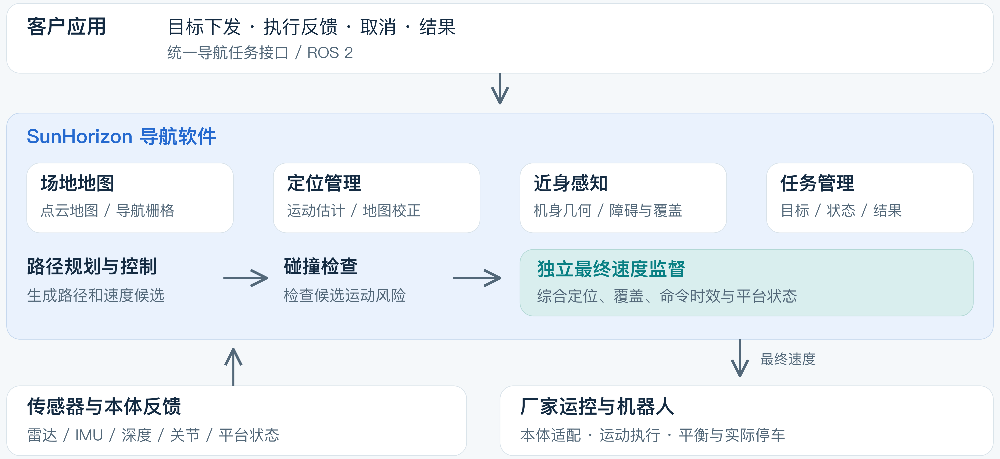
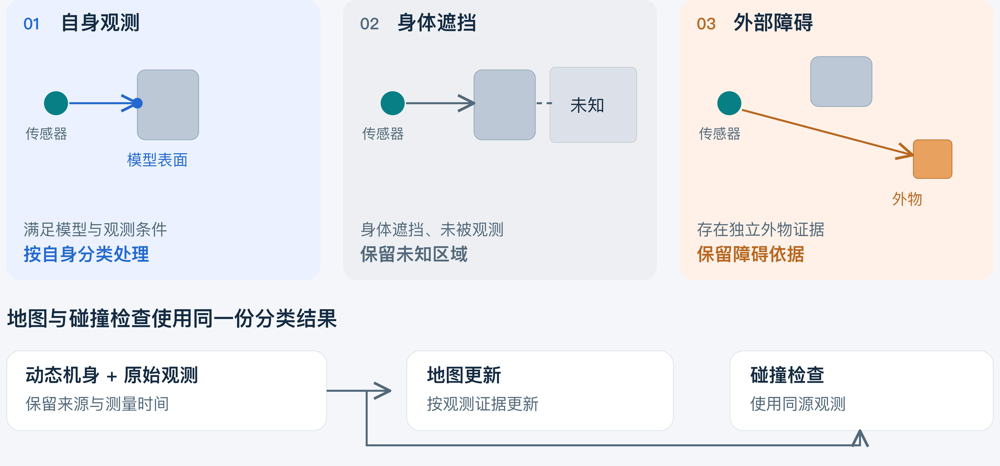
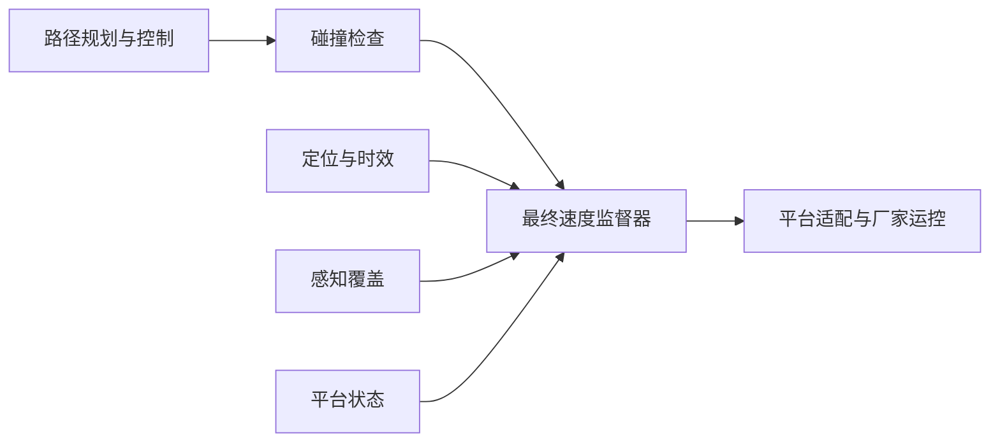

# SunHorizonNavigation 双泓科技

**面向人形机器人的 ROS 2 导航软件：让定位、近身感知、路径规划与运动监督使用一致、可追溯的观测。**

SunHorizonNavigation 关注机器人转腰、摆臂和迈步时的导航问题：雷达位姿随腰部变化，手脚会产生自身回波并遮挡环境，而规划出的速度必须在实际执行前再次核对感知与平台状态。

本仓提供导航主线源码与独立离线测试，采用 [Apache-2.0](LICENSE)。**当前是源码审阅候选，完整运行所需的二开依赖尚未公开，不是开箱即用的机器人部署包。**

[架构说明](docs/architecture.md) · [18 个包的职责](docs/packages.md) · [依赖与验证范围](docs/scope.md)

## 主要能力

| 环节 | 人形机器人遇到的问题 | 源码中的处理方式 |
|---|---|---|
| 定位 | 腰部转动会改变雷达与基座的相对姿态 | 结合观测时间和关节反馈转换位姿，校验地图匹配质量、连续性与时效 |
| 近身感知 | 手脚回波、身体遮挡与真实障碍容易混淆 | 根据动态机身几何分类观测；遮挡不当作自由空间，独立外物证据继续保留 |
| 规划与碰撞检查 | 不同模块使用不同帧或不同分类会产生矛盾 | 向代价图与碰撞检查传递同源分类和时间信息，跟踪处理与命令来源 |
| 运动监督 | 刚算出的速度可能因定位或平台状态变化而失效 | 在最终输出前核对定位、覆盖、命令时效和平台状态，失效时置零并锁停 |
| 地图与集成 | 上层应用需要稳定接口 | 提供地图处理、导航任务、状态反馈和取消接口，机器人专用控制放在适配层 |

## 系统概览



图中展示完整系统的职责划分。主仓保留集成代码，LIVO、Nav2 等二开库及厂家 SDK 不随本仓分发；厂家运控负责运动执行、平衡与物理停车。

### 自身、遮挡与外部障碍



自体过滤依赖模型与观测条件。身体挡住视线时，后方没有被观测到，不能据此清除障碍；有独立外物观测时，仍需保留障碍证据。该图解释分类原则，不是某次真机实验结果。

### 从候选速度到最终输出



只有最终速度监督器发布 `/navigation/cmd_vel`。收到候选速度不等于获得运动许可；关键条件失效时，监督器输出零速度并锁停。零速度命令也不等于已经验证了真实停车距离。

## 阅读源码

| 想了解什么 | 建议入口 |
|---|---|
| 融合运行链与 Nav2 接入 | [navigation_runtime](ros2_ws/src/sunhorizon_navigation_runtime) |
| 定位与地图校正 | [livo_bringup](ros2_ws/src/sunhorizon_livo_bringup)、[3d_localizer](ros2_ws/src/sunhorizon_3d_localizer)、[localization_manager](ros2_ws/src/sunhorizon_localization_manager) |
| 深度与动态机身处理 | [rgbd_adapter](ros2_ws/src/sunhorizon_rgbd_adapter)、[perception_runtime](ros2_ws/src/sunhorizon_perception_runtime) |
| 覆盖判定与安全输出 | [obstacle_coverage](ros2_ws/src/sunhorizon_obstacle_coverage)、[velocity_supervisor](ros2_ws/src/sunhorizon_velocity_supervisor) |
| 对外导航接口 | [navigation_interfaces](ros2_ws/src/sunhorizon_navigation_interfaces)、[navigation_server](ros2_ws/src/sunhorizon_navigation_server) |

全部 18 个包及“主线必需／硬件适配／辅助工具”的区分见[包说明](docs/packages.md)。

## 运行离线测试

需要 CMake ≥ 3.16、C++17 编译器和 Python ≥ 3.10。在仓库根目录运行：

```bash
bash scripts/run_core_tests.sh
```

该脚本在临时目录构建，完成后清理构建产物，不启动 ROS 或连接机器人。本地 macOS 已通过 12 组测试，覆盖核心安全与定位逻辑、覆盖几何、地图工具和诊断子集。

完整 ROS 2/ARM 构建、CUDA 路径与实际行走未在此候选中验证。GitHub CI 文件已提供，尚未远程运行。离线测试结果不代表整机导航验收。

## 当前公开范围

- 包含 18 个主线与工具包、接口、保留组件的测试及说明。
- 不包含 `NavigationDependencies` 的二开源码、补丁或二进制；部分接口无法由官方上游版本直接替代。
- 不包含厂家 SDK、真实标定、现场地图、录包和部署配置。
- 已移除备用后端、旧组合启动与一次性现场试验入口；现用兼容、安全检查和回归测试保留。

现场演示、静态性能对比和回放结果不作为本候选的通用性能指标。完成实际部署仍需补齐依赖与硬件配置，并独立验证定位、感知、运动监督和整机行为。

## License

[Apache License 2.0](LICENSE)。已有版权声明保留。外部依赖遵循各自许可证，本仓许可不对它们重新授权。

## English

SunHorizonNavigation is a ROS 2 navigation source project for humanoid robots. It
combines localization, motion-aware body geometry, near-field perception, navigation
integration and fail-closed velocity supervision. This review candidate includes
18 packages and an independent offline test subset. Patched dependencies, vendor SDKs
and field assets are not distributed; a complete robot build or deployment is not
currently supported by this snapshot.
