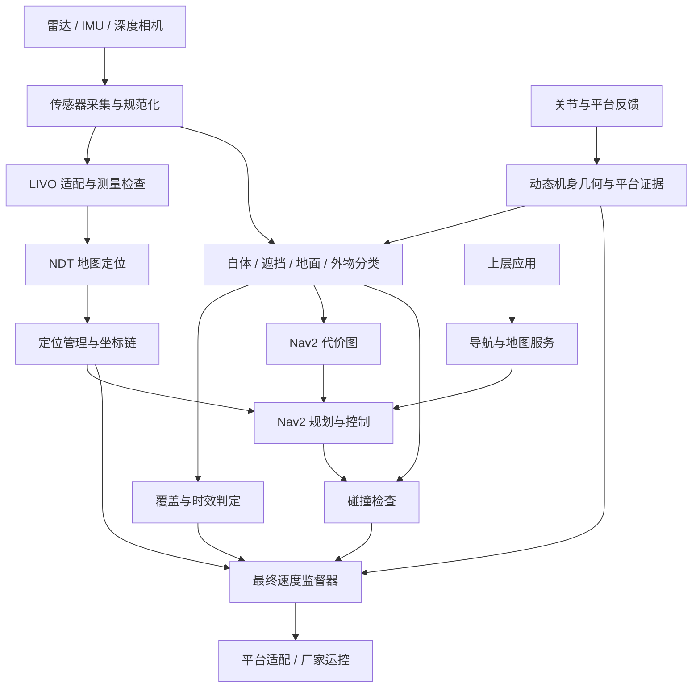

# 架构说明

SunHorizonNavigation 将上层任务接口、融合导航运行链、最终速度监督和厂家运控分开。核心问题是：一条速度命令是否来自仍然有效的定位和环境观测，以及机器人当前是否允许执行它。

本文描述保留源码的职责与接口，不表示缺失私有依赖的公开候选能够完整运行。

## 1. 数据与控制流



箭头表示逻辑数据流，不代表每一段都是独立 ROS 节点或 DDS 话题。`navigation_runtime` 通过直接接口组合多个模块；平台服务与最终速度监督器具有独立职责。

## 2. 传感器与动态机身

`airy_adapter` 处理雷达点云和 IMU 输入；`camera_runtime` 管理相机采集、帧身份与时序。`rgbd_adapter` 提供深度投影、自体过滤及相关空间观测处理。

`platform_adapter_casbot02` 提供当前平台的状态与关节证据。`perception_runtime` 使用关节反馈和标定几何计算动态机身关系，区分身体表面、被身体遮挡的空间、地面与外部障碍。

分类必须保留原始观测的时间与来源。接收回调发生在“现在”不代表测量发生在“现在”；腰部、关节变换需要与对应观测匹配。

参考：[感知运行链](../ros2_ws/src/sunhorizon_perception_runtime/src/runtime.cpp)、[动态自体模型](../ros2_ws/src/sunhorizon_rgbd_adapter/include/sunhorizon_rgbd_adapter/dynamic_self_model.hpp)。

## 3. 定位与坐标链

`livo_bringup` 虽然保留了历史包名，但包含正式的 `livo_direct_adapter` 库。它负责将估计结果接入主线，并检查测量连续性、时效和传播依据。

`3d_localizer` 实现地图匹配及质量、范围、连续性检查。`localization_manager` 管理跟踪位姿与地图校正，提供统一的定位状态和坐标关系。

设计坐标链为：

```text
map → odom → base_footprint → base_link → waist_yaw_link
    → lidar_mount → rslidar / imu_link
```

每段关系必须有唯一、明确的发布者；动态关节关系来自实测反馈，固定关系来自标定。上述名称是集成合同，不能用未经测量的固定变换替代动态腰部运动。

参考：[LIVO 适配](../ros2_ws/src/sunhorizon_livo_bringup/src/livo_adapter_node.cpp)、[NDT 实现](../ros2_ws/src/sunhorizon_3d_localizer/src/ndt_localizer_node.cpp)、[定位管理](../ros2_ws/src/sunhorizon_localization_manager/src/localization_manager_node.cpp)。

## 4. 规划、碰撞检查与最终速度

`navigation_runtime` 的 `nav2_assembly` 接入规划器、控制器、代价图和碰撞检查。代价图与碰撞检查接收可追溯的分类观测，而不是各自重新猜测一份障碍状态。

保留源码校验的命令链为：

```text
控制器
  /sunhorizon/navigation/cmd_vel_nav2_raw
    ↓ 碰撞检查
  /sunhorizon/navigation/cmd_vel_candidate
    ↓ 最终速度监督器
  /navigation/cmd_vel
    ↓ 平台适配与厂家运控
```

`velocity_supervisor` 独立检查候选命令时效、定位、TF、覆盖与平台状态。过期输入、定位失效或其他关键条件不成立时应置零并锁停；候选命令不能绕过这一步。

导航软件不负责底层平衡控制。最终零速度指令、厂家运控接受指令和机器人实际停住是三个不同的验证环节。

参考：[Nav2 接入与命令链校验](../ros2_ws/src/sunhorizon_navigation_runtime/src/nav2_assembly.cpp)、[最终速度监督](../ros2_ws/src/sunhorizon_velocity_supervisor/src/velocity_supervisor_node.cpp)。

## 5. 对外任务接口

`navigation_server` 提供业务无关的任务合同，不包含接待、对话或业务流程。

| 接口 | 用途 |
|---|---|
| `NavigateTo` Action | 提交地图与目标位姿，接收状态、距离、原因和结果 |
| `PlanTo` / `Cancel` | 路径请求与取消 |
| `StartMapping` / `StopMapping` | 建图任务接口 |
| `SaveMap` / `ValidateMap` / `LoadMap` | 地图管理 |
| `Localize` / `GetStatus` | 定位请求与状态查询 |

接口定义存在不意味着对应后端已经随仓提供。上层必须处理失败、超时和安全原因，不能仅凭任务已接受就判断机器人可以移动。

参考：[接口目录](../ros2_ws/src/sunhorizon_navigation_interfaces)、[服务实现](../ros2_ws/src/sunhorizon_navigation_server/src/navigation_server_node.cpp)。

## 6. 实现边界与依赖

| 部分 | 本仓包含 | 外部或未公开部分 |
|---|---|---|
| LIVO / 地图定位 | 适配、定位逻辑、质量与时效检查 | FAST-LIVO 二开库、部分 NDT CUDA ABI |
| Nav2 集成 | 运行组合、输入绑定与命令链校验 | 二开 Nav2 插件和直接接口 |
| 雷达与相机 | 规范化、采集集成、帧与时间处理 | 雷达/相机 SDK |
| 最终速度监督 | 监督器与安全判定 | 私有速度证据头文件 |
| 平台接入 | 当前平台适配源码 | 厂家消息、运控和真实硬件 |
| 地图与模型 | 处理工具和数据合同 | 现场地图、标定、模型与录包 |

`NavigationDependencies` 暂不公开，因此本仓没有 submodule，也没有复制其源码或库。不能将二开依赖直接替换成同名官方版本并假定兼容。

## 7. 保留与删除的界线

保留现用主线、必要的平台适配、地图/诊断工具与回归测试。备用定位后端、旧组合启动和独立现场运动试验已经移出本分支。

部分代码仍带历史兼容名称，例如 NDT 参数别名、先验跟踪模式和消息兼容字段。它们仍参与配置解析或保护检查，不能把“搜索不到 legacy”当作清理标准。`attended_geometry` 和行程保护也有现用调用。当前没有对这些路径做未经完整 ROS 回归验证的语义重构。

详细包分类见 [packages.md](packages.md)；测试与构建限制见 [scope.md](scope.md)。
